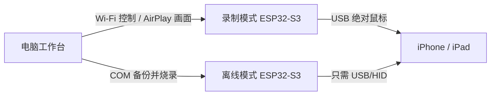

# Apple Mobile Recorder

**在电脑上操作 iPhone / iPad，录下点击，改好每步间隔，再烧入 ESP32-S3。离线时只需连接目标设备。**

基于 [ESP32 iPhone Agent](https://github.com/onehumanbeing/esp32-iphone-agent) by **Henry Yuan**，保留原 [MIT LICENSE](LICENSE) 和 [NOTICE](NOTICE)。对外演示、视频和文章也请注明原项目来源。

本项目把原来分散的命令整理为一个中文工作台：**设备档案 → 录制 → 时间表 → 试跑 → 生成固件 → 备份后烧录 → 离线执行**。录制和离线点击都不需要模型 API Key，也不用在手机上安装配套 App、开启开发者模式或处理签名有效期。

[查看工作台截图](docs/workbench.png) · [兼容性](docs/compatibility.md) · [排障](docs/troubleshooting.md) · [验证记录](docs/validation.md)

## 先看适用范围

| 项目 | 当前范围 |
| --- | --- |
| 电脑 | macOS / Apple Silicon 完成本次工作台验证；Windows、Linux 未做端到端验收 |
| 板卡 | 双口 ESP32-S3：COM 用于烧录，原生 USB/HID 接被控设备；参考构建为 ESP32 Arduino 3.3.12、8MB Flash 配置 |
| 被控设备 | 按 iPhone / iPad、接口、画面尺寸和横竖屏分别建档。核心 USB 绝对定位在 iPad14,3 验收过；其他机型需单独验收 |
| 离线动作 | **点击**，最多256步；支持每步间隔、启动倒计时、指定轮数或无限循环 |
| 电脑试跑 | 保留目标局部画面和实际指针检查，页面不符会暂停 |
| 离线限制 | 无画面输入，不能识别弹窗、列表到底或页面变化；坐标相同不代表页面始终正确 |

Lightning 机型需要适用的转接与供电方案，本项目没有实测该组合。**不能因为苹果支持鼠标，就宣称本项目所有 iPhone / iPad 均已适配。** 接线和官方依据见 [兼容性说明](docs/compatibility.md)。

## 你日常只需要这条流程

### 第一次准备电脑

已安装 Homebrew 的 Mac，运行一次：

```sh
bash scripts/setup-macos.sh
```

随后双击 **[启动工作台.command](启动工作台.command)**，浏览器打开 `http://127.0.0.1:8990/`，AirPlay 接收器名为 **Apple Recorder**。首次安装会准备 Python、UxPlay、Arduino 工具及固定版本的板卡支持包，**不会自行烧录设备**。

### 录一套新操作

1. 在工作台展开“需要重新录制？”，填写 Wi-Fi 和电脑局域网地址，生成**录制模式固件**。
2. 选择板子的 **COM** 口，点“备份后烧录”。未初始化空板才勾选“初始化空板”。
3. 将板子 **USB/HID** 口接目标 iPhone / iPad，解锁并开启辅助触控。
4. 在该设备“控制中心 → 屏幕镜像”中选择 **Apple Recorder**。
5. 在工作台选择设备类型、接口和方向，确认画面尺寸与目标设备一致。
6. 点“开始录制”，在电脑实时画面上完成点击，点“完成录制”，再点“保存刚才的录制”。

录制使用 USB **绝对定位**。不做相对位移累加；每次精准点击仍检查实际指针。若画面来自另一台设备、投屏断开或页面比例发生变化，应先处理再继续。新工作台只录制离线支持的点击，不会偷偷忽略滑动、输入等动作。

### 改时间、生成、烧录

1. 在时间表逐步修改**执行前的间隔**，必要时删除多余步骤。
2. 首次将循环次数设为 **1**，保存参数，并在起始页面做“电脑试跑1轮”。
3. 点“生成离线固件”，核对步骤数量、时间表和周期。
4. 选择 COM 口，点“备份后烧录到 ESP32”。
5. 新离线固件首次保持待机；保持 COM 供电，待 HID 已连接后，**仅拔下 USB/HID 并重插**，解除首次部署锁。
6. 看真实设备是否正确完成一轮；通过后再把循环次数改为 **0**、重新生成并烧录，启用持续循环。

参数编辑后必须重新生成固件。界面会使旧“烧录”按钮失效，服务端也会拒绝把旧参数固件当作最新项目烧录。每次生成使用独立目录、部署编号和 SHA256，不覆盖其他录制的构建文件。

### 脱离电脑使用

回到录制的起始页面，连接 USB/HID，等待设定倒计时。支持供电的设备可以不接 COM；板卡、线材和移动设备供电能力仍需实际确认。

**停止按实体 BOOT，或拔掉 USB/HID。网页 Esc 只停止电脑回放，不能停止板内离线执行。EN/RESET 是复位，不是停止。** 新固件的首次待机锁不会因为断电消失，须按上面的 COM 供电 + HID 重插流程启用。

## 每步间隔的准确含义

间隔按**上一步开始定位 → 本步开始定位**计时，已经包含定位稳定和按压，不是点击后再额外加一遍等待。

默认固定保留 **350ms 定位稳定 + 60ms 按压**，释放后至少90ms，因此最短间隔为 **500ms**。项目校验会拒绝更短的值，不会表面写0.5秒、实际却被旧的1秒下限拖慢。

现有 iPad 六步示例的间隔为：

| 步骤 | 执行前间隔 |
| --- | ---: |
| 1 | 3秒，接上一轮第6步 |
| 2～5 | 各0.5秒 |
| 6 | 2.588秒 |
| 合计 | 7.588秒/轮，不含首次倒计时 |

[现有 iPad 示例](examples/ipad-six-step.json) 仅适用于原设备和原页面布局，不能直接拿去操作另一台 iPhone。[iPhone 示例](examples/iphone-nine-point.json) 展示通用项目格式，使用前应在对应设备重新录制。新设备建议先在 [九点测试页](examples/targets/index.html) 验收，避免拿真实业务试错。

## 两种固件不要混淆



| | 录制模式 | 离线模式 |
| --- | --- | --- |
| 电脑 / Wi-Fi | 需要 | 执行时不需要 |
| 画面校验 | 电脑保留 | 没有 |
| 网页停止 | 有效 | 无效，用 BOOT / 拔线 |
| 换录制 | 工作台保存项目 | 重新生成并烧录 |

多个设备的录制分开保存。切换横竖屏、显示缩放或应用布局后，重新录制；项目不会自动识别插入的设备身份，也不会把同一套坐标自动适配到所有屏幕。

## 备份、恢复与数据

- 默认数据在 `~/.apple-mobile-recorder/studio/`，只有当前用户可访问。项目 JSON 不含画面；电脑试跑的原图校验依据仅在本机保存。
- 每次烧录先读取板型、启动区、分区表和应用区。分区不兼容、备份失败或固件 SHA256 改变时不写入；备份步骤之间保持下载模式，避免误启动旧循环。
- 默认只写应用区 `0x10000`。明确勾选空板初始化且启动区确实为空时，才写对应启动文件和分区表。
- 烧录后可点“恢复烧录前版本”，或按 [CLI 说明](docs/architecture.md) 指定原烧录任务恢复。恢复时核对原板卡 MAC 与备份哈希。
- 备份是应用/启动区快照，**不是完整 Flash / NVS 克隆**。录制模式二进制可能含 Wi-Fi 连接配置，不能上传到公开仓库。
- 串口115200模式优先稳定；读取应用备份可能需要数分钟。这段耗时不代表卡死。不要在烧录写入时拔线。

## 已验证与待验证

原核心在 iPad14,3 上完成绝对定位、循环和无 COM 运行验证；六步半秒版首步1.435秒也经用户确认正常。首步加长到3秒的原板端版本只有烧录和板端自检记录，尚无该版页面验收。

本仓库增加的通用工作台另行测试：参数编辑/恢复、生成链路、项目校验、备份失败拦截、独立构建及有限轮数。**浏览器测试、编译成功、板端自检、真实页面成功是不同证据。** 详细记录见 [验证记录](docs/validation.md)。

## 少走弯路

遇到问题先看 [排障](docs/troubleshooting.md)：端口接反、画面与被控设备不一致、相对鼠标漂移、AirPlay首帧后不更新、首次部署锁、打开 COM 触发复位、离线无法识别弹窗等，均有对应检查路径。

开发、命令行、构建目录和接口说明见 [架构与CLI](docs/architecture.md)。本机改动保留了 [UxPlay 来源和补丁说明](integrations/uxplay/README.md)；UxPlay 单独遵循其 GPL 许可，不并入本项目 MIT 许可。
